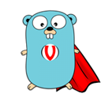
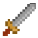
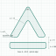
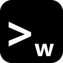
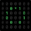
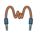

<picture><source media="(prefers-color-scheme: dark) and (max-width: 500px)" srcset="assets/intro-compact-dark.svg?v=40701025366becd2"><source media="(max-width: 500px)" srcset="assets/intro-compact-light.svg?v=33d44fd276df48af"><source media="(prefers-color-scheme: dark)" srcset="assets/intro-dark.svg?v=83444e85f7c80017"></picture>

Game fan | Algorithm lover | ICPC World Finalist | Formerly at Microsoft and Google.

I'm currently developing indie games, working on AI harnesses, and building my own AI & software studio.

I hate lies. So, so, so much. (｡•́︿•̀｡)

For many years, I put my own interests aside to devote myself to volunteer work. ❤️

<a href="https://snowy-smile.com/" title="Website — snowy-smile.com"><picture><source media="(prefers-color-scheme: dark)" srcset="assets/contact-website-dark.svg?v=76a76b6e859d83f9"></picture></a>
<a href="https://x.com/snowy_smile_" title="X — @snowy_smile_"><picture><source media="(prefers-color-scheme: dark)" srcset="assets/contact-x-dark.svg?v=de00ad8d3c96da7e"></picture></a>
<a href="https://discord.com/users/676210679899881484" title="Discord — say hello to Snowy"><picture><source media="(prefers-color-scheme: dark)" srcset="assets/contact-discord-dark.svg?v=70f042b56c18d9b1"></picture></a>

## Things I make

Tools for colour, creative work, everyday computing, and discovering games.

<a href="https://huemantics.pages.dev/"><picture><source media="(prefers-color-scheme: dark)" srcset="assets/work-huemantics-dark.svg?v=b0c157706c9950f6"></picture></a>
<a href="https://ai-iconflow.com/"><picture><source media="(prefers-color-scheme: dark)" srcset="assets/work-iconflow-dark.svg?v=ca1bb167f5551f4a"></picture></a>
<a href="https://tgs.best/"><picture><source media="(prefers-color-scheme: dark)" srcset="assets/work-tgs-dark.svg?v=e690c3b2c472273f"></picture></a>
<a href="https://github.com/snowyukitty/LumenDeck"><picture><source media="(prefers-color-scheme: dark)" srcset="assets/work-lumendeck-dark.svg?v=3165ffb63bfc34fe"></picture></a>
<a href="https://github.com/snowyukitty/morflo"><picture><source media="(prefers-color-scheme: dark)" srcset="assets/work-morflo-dark.svg?v=48103c62955b3a3c"></picture></a>
<a href="https://github.com/snowyukitty/agent-orchestrator"><picture><source media="(prefers-color-scheme: dark)" srcset="assets/work-orchestrator-dark.svg?v=a1a41332723dd74b"></picture></a>

Development previews are labelled on their cards.

## Merged upstream

**216 merged PRs · 115 projects** outside my personal namespace.

### By project Stars

Six projects I've contributed to, ranked by their Stars.

<a href="https://github.com/remotion-dev/remotion/pulls?q=is%3Apr%20is%3Amerged%20author%3Asnowyukitty"><picture><source media="(prefers-color-scheme: dark)" srcset="assets/contribution-0-dark.svg?v=809e28d2cdaa7796"></picture></a>
<a href="https://github.com/xyflow/xyflow/pulls?q=is%3Apr%20is%3Amerged%20author%3Asnowyukitty"><picture><source media="(prefers-color-scheme: dark)" srcset="assets/contribution-1-dark.svg?v=b2a0650df5816a61"></picture></a>
<a href="https://github.com/dgtlmoon/changedetection.io/pulls?q=is%3Apr%20is%3Amerged%20author%3Asnowyukitty"><picture><source media="(prefers-color-scheme: dark)" srcset="assets/contribution-2-dark.svg?v=196f433f76d4dfb1"></picture></a>
<a href="https://github.com/raysan5/raylib/pulls?q=is%3Apr%20is%3Amerged%20author%3Asnowyukitty"><picture><source media="(prefers-color-scheme: dark)" srcset="assets/contribution-3-dark.svg?v=6c81d8ffe1fd91d5"></picture></a>
<a href="https://github.com/nicolargo/glances/pulls?q=is%3Apr%20is%3Amerged%20author%3Asnowyukitty"><picture><source media="(prefers-color-scheme: dark)" srcset="assets/contribution-4-dark.svg?v=5cae1e4c284a4788"></picture></a>
<a href="https://github.com/4ian/GDevelop/pulls?q=is%3Apr%20is%3Amerged%20author%3Asnowyukitty"><picture><source media="(prefers-color-scheme: dark)" srcset="assets/contribution-5-dark.svg?v=189cd6514a289d5e"></picture></a>

### By merged PRs

The six projects with the most of my merged PRs. Ties are ordered by project Stars.

<a href="https://github.com/openwong2kim/wmux/pulls?q=is%3Apr%20is%3Amerged%20author%3Asnowyukitty"><picture><source media="(prefers-color-scheme: dark)" srcset="assets/merged-0-dark.svg?v=6144a01992298e1b"></picture></a>
<a href="https://github.com/lidge-jun/opencodex/pulls?q=is%3Apr%20is%3Amerged%20author%3Asnowyukitty"><picture><source media="(prefers-color-scheme: dark)" srcset="assets/merged-1-dark.svg?v=525365f48342da9c"></picture></a>
<a href="https://github.com/melonjs/melonJS/pulls?q=is%3Apr%20is%3Amerged%20author%3Asnowyukitty"><picture><source media="(prefers-color-scheme: dark)" srcset="assets/merged-2-dark.svg?v=6280ed3397c5c336"></picture></a>
<a href="https://github.com/dgtlmoon/changedetection.io/pulls?q=is%3Apr%20is%3Amerged%20author%3Asnowyukitty"><picture><source media="(prefers-color-scheme: dark)" srcset="assets/merged-3-dark.svg?v=9a364d2be13295fb"></picture></a>
<a href="https://github.com/getkin/kin-openapi/pulls?q=is%3Apr%20is%3Amerged%20author%3Asnowyukitty"><picture><source media="(prefers-color-scheme: dark)" srcset="assets/merged-4-dark.svg?v=4bacc49ab00da833"></picture></a>
<a href="https://github.com/felladrin/MiniSearch/pulls?q=is%3Apr%20is%3Amerged%20author%3Asnowyukitty"><picture><source media="(prefers-color-scheme: dark)" srcset="assets/merged-5-dark.svg?v=52b9c149e53f7d45"></picture></a>

◦ Owner avatar used where a distinct project icon has not been curated.

Public GitHub snapshot · 2026-11-07. Stars describe the project; merged PR counts describe my contributions.

Explore all 115 projects and the merged PRs

<table><thead><tr><th>Project</th><th>Stars</th><th>My merged PRs</th><th>PR links</th></tr></thead><tbody><tr><td><a href="https://github.com/remotion-dev/remotion"> remotion-dev/remotion</a></td><td align="right">71,367</td><td align="right"><a href="https://github.com/remotion-dev/remotion/pulls?q=is%3Apr%20is%3Amerged%20author%3Asnowyukitty"><b>1</b></a></td><td><a href="https://github.com/remotion-dev/remotion/pull/11965">#11965</a></td></tr>
<tr><td><a href="https://github.com/xyflow/xyflow"> xyflow/xyflow</a></td><td align="right">38,926</td><td align="right"><a href="https://github.com/xyflow/xyflow/pulls?q=is%3Apr%20is%3Amerged%20author%3Asnowyukitty"><b>1</b></a></td><td><a href="https://github.com/xyflow/xyflow/pull/6068">#6068</a></td></tr>
<tr><td><a href="https://github.com/dgtlmoon/changedetection.io"> dgtlmoon/changedetection.io</a></td><td align="right">35,600</td><td align="right"><a href="https://github.com/dgtlmoon/changedetection.io/pulls?q=is%3Apr%20is%3Amerged%20author%3Asnowyukitty"><b>4</b></a></td><td><a href="https://github.com/dgtlmoon/changedetection.io/pull/4294">#4294</a> · <a href="https://github.com/dgtlmoon/changedetection.io/pull/4289">#4289</a> · <a href="https://github.com/dgtlmoon/changedetection.io/pull/4286">#4286</a></td></tr>
<tr><td><a href="https://github.com/raysan5/raylib"> raysan5/raylib</a></td><td align="right">35,570</td><td align="right"><a href="https://github.com/raysan5/raylib/pulls?q=is%3Apr%20is%3Amerged%20author%3Asnowyukitty"><b>1</b></a></td><td><a href="https://github.com/raysan5/raylib/pull/6215">#6215</a></td></tr>
<tr><td><a href="https://github.com/nicolargo/glances"> nicolargo/glances</a></td><td align="right">33,908</td><td align="right"><a href="https://github.com/nicolargo/glances/pulls?q=is%3Apr%20is%3Amerged%20author%3Asnowyukitty"><b>1</b></a></td><td><a href="https://github.com/nicolargo/glances/pull/3817">#3817</a></td></tr>
<tr><td><a href="https://github.com/4ian/GDevelop"> 4ian/GDevelop</a></td><td align="right">28,525</td><td align="right"><a href="https://github.com/4ian/GDevelop/pulls?q=is%3Apr%20is%3Amerged%20author%3Asnowyukitty"><b>1</b></a></td><td><a href="https://github.com/4ian/GDevelop/pull/9253">#9253</a></td></tr>
<tr><td><a href="https://github.com/Automattic/mongoose"> Automattic/mongoose</a></td><td align="right">27,451</td><td align="right"><a href="https://github.com/Automattic/mongoose/pulls?q=is%3Apr%20is%3Amerged%20author%3Asnowyukitty"><b>1</b></a></td><td><a href="https://github.com/Automattic/mongoose/pull/16435">#16435</a></td></tr>
<tr><td><a href="https://github.com/go-playground/validator"> go-playground/validator</a></td><td align="right">20,219</td><td align="right"><a href="https://github.com/go-playground/validator/pulls?q=is%3Apr%20is%3Amerged%20author%3Asnowyukitty"><b>1</b></a></td><td><a href="https://github.com/go-playground/validator/pull/1600">#1600</a></td></tr>
<tr><td><a href="https://github.com/lidge-jun/opencodex"> lidge-jun/opencodex</a></td><td align="right">18,270</td><td align="right"><a href="https://github.com/lidge-jun/opencodex/pulls?q=is%3Apr%20is%3Amerged%20author%3Asnowyukitty"><b>6</b></a></td><td><a href="https://github.com/lidge-jun/opencodex/pull/2532">#2532</a> · <a href="https://github.com/lidge-jun/opencodex/pull/2232">#2232</a> · <a href="https://github.com/lidge-jun/opencodex/pull/1240">#1240</a></td></tr>
<tr><td><a href="https://github.com/OpenRA/OpenRA"> OpenRA/OpenRA</a></td><td align="right">17,742</td><td align="right"><a href="https://github.com/OpenRA/OpenRA/pulls?q=is%3Apr%20is%3Amerged%20author%3Asnowyukitty"><b>1</b></a></td><td><a href="https://github.com/OpenRA/OpenRA/pull/22623">#22623</a></td></tr>
<tr><td><a href="https://github.com/less/less.js"> less/less.js</a></td><td align="right">17,003</td><td align="right"><a href="https://github.com/less/less.js/pulls?q=is%3Apr%20is%3Amerged%20author%3Asnowyukitty"><b>1</b></a></td><td><a href="https://github.com/less/less.js/pull/4486">#4486</a></td></tr>
<tr><td><a href="https://github.com/ast-grep/ast-grep"> ast-grep/ast-grep</a> ◦</td><td align="right">16,470</td><td align="right"><a href="https://github.com/ast-grep/ast-grep/pulls?q=is%3Apr%20is%3Amerged%20author%3Asnowyukitty"><b>1</b></a></td><td><a href="https://github.com/ast-grep/ast-grep/pull/2868">#2868</a></td></tr>
<tr><td><a href="https://github.com/Tonejs/Tone.js"> Tonejs/Tone.js</a> ◦</td><td align="right">14,890</td><td align="right"><a href="https://github.com/Tonejs/Tone.js/pulls?q=is%3Apr%20is%3Amerged%20author%3Asnowyukitty"><b>1</b></a></td><td><a href="https://github.com/Tonejs/Tone.js/pull/1528">#1528</a></td></tr>
<tr><td><a href="https://github.com/darrenburns/posting"> darrenburns/posting</a> ◦</td><td align="right">12,609</td><td align="right"><a href="https://github.com/darrenburns/posting/pulls?q=is%3Apr%20is%3Amerged%20author%3Asnowyukitty"><b>1</b></a></td><td><a href="https://github.com/darrenburns/posting/pull/392">#392</a></td></tr>
<tr><td><a href="https://github.com/cloudflare/cloudflare-os"> cloudflare/cloudflare-os</a> ◦</td><td align="right">11,707</td><td align="right"><a href="https://github.com/cloudflare/cloudflare-os/pulls?q=is%3Apr%20is%3Amerged%20author%3Asnowyukitty"><b>2</b></a></td><td><a href="https://github.com/cloudflare/cloudflare-os/pull/653">#653</a> · <a href="https://github.com/cloudflare/cloudflare-os/pull/221">#221</a></td></tr>
<tr><td><a href="https://github.com/Immediate-Mode-UI/Nuklear"> Immediate-Mode-UI/Nuklear</a> ◦</td><td align="right">11,485</td><td align="right"><a href="https://github.com/Immediate-Mode-UI/Nuklear/pulls?q=is%3Apr%20is%3Amerged%20author%3Asnowyukitty"><b>1</b></a></td><td><a href="https://github.com/Immediate-Mode-UI/Nuklear/pull/993">#993</a></td></tr>
<tr><td><a href="https://github.com/gka/chroma.js"> gka/chroma.js</a> ◦</td><td align="right">10,604</td><td align="right"><a href="https://github.com/gka/chroma.js/pulls?q=is%3Apr%20is%3Amerged%20author%3Asnowyukitty"><b>1</b></a></td><td><a href="https://github.com/gka/chroma.js/pull/407">#407</a></td></tr>
<tr><td><a href="https://github.com/lutris/lutris"> lutris/lutris</a> ◦</td><td align="right">10,365</td><td align="right"><a href="https://github.com/lutris/lutris/pulls?q=is%3Apr%20is%3Amerged%20author%3Asnowyukitty"><b>2</b></a></td><td><a href="https://github.com/lutris/lutris/pull/6957">#6957</a> · <a href="https://github.com/lutris/lutris/pull/6953">#6953</a></td></tr>
<tr><td><a href="https://github.com/tonyantony300/dashbeam"> tonyantony300/dashbeam</a> ◦</td><td align="right">10,246</td><td align="right"><a href="https://github.com/tonyantony300/dashbeam/pulls?q=is%3Apr%20is%3Amerged%20author%3Asnowyukitty"><b>1</b></a></td><td><a href="https://github.com/tonyantony300/dashbeam/pull/311">#311</a></td></tr>
<tr><td><a href="https://github.com/jonobr1/two.js"> jonobr1/two.js</a> ◦</td><td align="right">8,699</td><td align="right"><a href="https://github.com/jonobr1/two.js/pulls?q=is%3Apr%20is%3Amerged%20author%3Asnowyukitty"><b>1</b></a></td><td><a href="https://github.com/jonobr1/two.js/pull/884">#884</a></td></tr>
<tr><td><a href="https://github.com/isomorphic-git/isomorphic-git"> isomorphic-git/isomorphic-git</a> ◦</td><td align="right">8,387</td><td align="right"><a href="https://github.com/isomorphic-git/isomorphic-git/pulls?q=is%3Apr%20is%3Amerged%20author%3Asnowyukitty"><b>1</b></a></td><td><a href="https://github.com/isomorphic-git/isomorphic-git/pull/2451">#2451</a></td></tr>
<tr><td><a href="https://github.com/ducaale/xh"> ducaale/xh</a> ◦</td><td align="right">8,170</td><td align="right"><a href="https://github.com/ducaale/xh/pulls?q=is%3Apr%20is%3Amerged%20author%3Asnowyukitty"><b>1</b></a></td><td><a href="https://github.com/ducaale/xh/pull/470">#470</a></td></tr>
<tr><td><a href="https://github.com/fontforge/fontforge"> fontforge/fontforge</a> ◦</td><td align="right">8,062</td><td align="right"><a href="https://github.com/fontforge/fontforge/pulls?q=is%3Apr%20is%3Amerged%20author%3Asnowyukitty"><b>1</b></a></td><td><a href="https://github.com/fontforge/fontforge/pull/5935">#5935</a></td></tr>
<tr><td><a href="https://github.com/melonjs/melonJS"> melonjs/melonJS</a></td><td align="right">6,440</td><td align="right"><a href="https://github.com/melonjs/melonJS/pulls?q=is%3Apr%20is%3Amerged%20author%3Asnowyukitty"><b>6</b></a></td><td><a href="https://github.com/melonjs/melonJS/pull/1840">#1840</a> · <a href="https://github.com/melonjs/melonJS/pull/1734">#1734</a> · <a href="https://github.com/melonjs/melonJS/pull/1732">#1732</a></td></tr>
<tr><td><a href="https://github.com/JannisX11/blockbench"> JannisX11/blockbench</a> ◦</td><td align="right">6,169</td><td align="right"><a href="https://github.com/JannisX11/blockbench/pulls?q=is%3Apr%20is%3Amerged%20author%3Asnowyukitty"><b>1</b></a></td><td><a href="https://github.com/JannisX11/blockbench/pull/3842">#3842</a></td></tr>
<tr><td><a href="https://github.com/hacdias/webdav"> hacdias/webdav</a> ◦</td><td align="right">5,965</td><td align="right"><a href="https://github.com/hacdias/webdav/pulls?q=is%3Apr%20is%3Amerged%20author%3Asnowyukitty"><b>1</b></a></td><td><a href="https://github.com/hacdias/webdav/pull/344">#344</a></td></tr>
<tr><td><a href="https://github.com/maziyarpanahi/openmed"> maziyarpanahi/openmed</a> ◦</td><td align="right">5,784</td><td align="right"><a href="https://github.com/maziyarpanahi/openmed/pulls?q=is%3Apr%20is%3Amerged%20author%3Asnowyukitty"><b>1</b></a></td><td><a href="https://github.com/maziyarpanahi/openmed/pull/3977">#3977</a></td></tr>
<tr><td><a href="https://github.com/kornelski/pngquant"> kornelski/pngquant</a> ◦</td><td align="right">5,773</td><td align="right"><a href="https://github.com/kornelski/pngquant/pulls?q=is%3Apr%20is%3Amerged%20author%3Asnowyukitty"><b>1</b></a></td><td><a href="https://github.com/kornelski/pngquant/pull/433">#433</a></td></tr>
<tr><td><a href="https://github.com/fonttools/fonttools"> fonttools/fonttools</a> ◦</td><td align="right">5,309</td><td align="right"><a href="https://github.com/fonttools/fonttools/pulls?q=is%3Apr%20is%3Amerged%20author%3Asnowyukitty"><b>1</b></a></td><td><a href="https://github.com/fonttools/fonttools/pull/4374">#4374</a></td></tr>
<tr><td><a href="https://github.com/OGRECave/ogre"> OGRECave/ogre</a> ◦</td><td align="right">4,692</td><td align="right"><a href="https://github.com/OGRECave/ogre/pulls?q=is%3Apr%20is%3Amerged%20author%3Asnowyukitty"><b>2</b></a></td><td><a href="https://github.com/OGRECave/ogre/pull/3751">#3751</a> · <a href="https://github.com/OGRECave/ogre/pull/3750">#3750</a></td></tr>
<tr><td><a href="https://github.com/open-legal-products/mike"> open-legal-products/mike</a> ◦</td><td align="right">4,428</td><td align="right"><a href="https://github.com/open-legal-products/mike/pulls?q=is%3Apr%20is%3Amerged%20author%3Asnowyukitty"><b>2</b></a></td><td><a href="https://github.com/open-legal-products/mike/pull/449">#449</a> · <a href="https://github.com/open-legal-products/mike/pull/283">#283</a></td></tr>
<tr><td><a href="https://github.com/open-wanderer/wanderer"> open-wanderer/wanderer</a> ◦</td><td align="right">4,057</td><td align="right"><a href="https://github.com/open-wanderer/wanderer/pulls?q=is%3Apr%20is%3Amerged%20author%3Asnowyukitty"><b>2</b></a></td><td><a href="https://github.com/open-wanderer/wanderer/pull/1314">#1314</a> · <a href="https://github.com/open-wanderer/wanderer/pull/1134">#1134</a></td></tr>
<tr><td><a href="https://github.com/DingTalk-Real-AI/dingtalk-workspace-cli"> DingTalk-Real-AI/dingtalk-workspace-cli</a> ◦</td><td align="right">3,942</td><td align="right"><a href="https://github.com/DingTalk-Real-AI/dingtalk-workspace-cli/pulls?q=is%3Apr%20is%3Amerged%20author%3Asnowyukitty"><b>1</b></a></td><td><a href="https://github.com/DingTalk-Real-AI/dingtalk-workspace-cli/pull/1016">#1016</a></td></tr>
<tr><td><a href="https://github.com/agent-of-empires/agent-of-empires"> agent-of-empires/agent-of-empires</a> ◦</td><td align="right">3,668</td><td align="right"><a href="https://github.com/agent-of-empires/agent-of-empires/pulls?q=is%3Apr%20is%3Amerged%20author%3Asnowyukitty"><b>1</b></a></td><td><a href="https://github.com/agent-of-empires/agent-of-empires/pull/4669">#4669</a></td></tr>
<tr><td><a href="https://github.com/SurgeDM/Surge"> SurgeDM/Surge</a> ◦</td><td align="right">3,625</td><td align="right"><a href="https://github.com/SurgeDM/Surge/pulls?q=is%3Apr%20is%3Amerged%20author%3Asnowyukitty"><b>1</b></a></td><td><a href="https://github.com/SurgeDM/Surge/pull/581">#581</a></td></tr>
<tr><td><a href="https://github.com/opentk/opentk"> opentk/opentk</a> ◦</td><td align="right">3,548</td><td align="right"><a href="https://github.com/opentk/opentk/pulls?q=is%3Apr%20is%3Amerged%20author%3Asnowyukitty"><b>1</b></a></td><td><a href="https://github.com/opentk/opentk/pull/1931">#1931</a></td></tr>
<tr><td><a href="https://github.com/getkin/kin-openapi"> getkin/kin-openapi</a> ◦</td><td align="right">3,322</td><td align="right"><a href="https://github.com/getkin/kin-openapi/pulls?q=is%3Apr%20is%3Amerged%20author%3Asnowyukitty"><b>3</b></a></td><td><a href="https://github.com/getkin/kin-openapi/pull/1252">#1252</a> · <a href="https://github.com/getkin/kin-openapi/pull/1233">#1233</a> · <a href="https://github.com/getkin/kin-openapi/pull/1228">#1228</a></td></tr>
<tr><td><a href="https://github.com/recp/cglm"> recp/cglm</a> ◦</td><td align="right">3,045</td><td align="right"><a href="https://github.com/recp/cglm/pulls?q=is%3Apr%20is%3Amerged%20author%3Asnowyukitty"><b>1</b></a></td><td><a href="https://github.com/recp/cglm/pull/505">#505</a></td></tr>
<tr><td><a href="https://github.com/uiwjs/react-md-editor"> uiwjs/react-md-editor</a> ◦</td><td align="right">2,936</td><td align="right"><a href="https://github.com/uiwjs/react-md-editor/pulls?q=is%3Apr%20is%3Amerged%20author%3Asnowyukitty"><b>1</b></a></td><td><a href="https://github.com/uiwjs/react-md-editor/pull/713">#713</a></td></tr>
<tr><td><a href="https://github.com/ValveResourceFormat/ValveResourceFormat"> ValveResourceFormat/ValveResourceFormat</a> ◦</td><td align="right">2,550</td><td align="right"><a href="https://github.com/ValveResourceFormat/ValveResourceFormat/pulls?q=is%3Apr%20is%3Amerged%20author%3Asnowyukitty"><b>1</b></a></td><td><a href="https://github.com/ValveResourceFormat/ValveResourceFormat/pull/1264">#1264</a></td></tr>
<tr><td><a href="https://github.com/RevylAI/greenlight"> RevylAI/greenlight</a> ◦</td><td align="right">2,466</td><td align="right"><a href="https://github.com/RevylAI/greenlight/pulls?q=is%3Apr%20is%3Amerged%20author%3Asnowyukitty"><b>1</b></a></td><td><a href="https://github.com/RevylAI/greenlight/pull/28">#28</a></td></tr>
<tr><td><a href="https://github.com/excaliburjs/Excalibur"> excaliburjs/Excalibur</a> ◦</td><td align="right">2,362</td><td align="right"><a href="https://github.com/excaliburjs/Excalibur/pulls?q=is%3Apr%20is%3Amerged%20author%3Asnowyukitty"><b>1</b></a></td><td><a href="https://github.com/excaliburjs/Excalibur/pull/3873">#3873</a></td></tr>
<tr><td><a href="https://github.com/mampfes/hacs_waste_collection_schedule"> mampfes/hacs_waste_collection_schedule</a> ◦</td><td align="right">2,307</td><td align="right"><a href="https://github.com/mampfes/hacs_waste_collection_schedule/pulls?q=is%3Apr%20is%3Amerged%20author%3Asnowyukitty"><b>2</b></a></td><td><a href="https://github.com/mampfes/hacs_waste_collection_schedule/pull/7217">#7217</a> · <a href="https://github.com/mampfes/hacs_waste_collection_schedule/pull/7079">#7079</a></td></tr>
<tr><td><a href="https://github.com/HaxeFlixel/flixel"> HaxeFlixel/flixel</a> ◦</td><td align="right">2,238</td><td align="right"><a href="https://github.com/HaxeFlixel/flixel/pulls?q=is%3Apr%20is%3Amerged%20author%3Asnowyukitty"><b>1</b></a></td><td><a href="https://github.com/HaxeFlixel/flixel/pull/3663">#3663</a></td></tr>
<tr><td><a href="https://github.com/pythonarcade/arcade"> pythonarcade/arcade</a> ◦</td><td align="right">2,100</td><td align="right"><a href="https://github.com/pythonarcade/arcade/pulls?q=is%3Apr%20is%3Amerged%20author%3Asnowyukitty"><b>2</b></a></td><td><a href="https://github.com/pythonarcade/arcade/pull/2959">#2959</a> · <a href="https://github.com/pythonarcade/arcade/pull/2932">#2932</a></td></tr>
<tr><td><a href="https://github.com/opensheetmusicdisplay/opensheetmusicdisplay"> opensheetmusicdisplay/opensheetmusicdisplay</a> ◦</td><td align="right">2,011</td><td align="right"><a href="https://github.com/opensheetmusicdisplay/opensheetmusicdisplay/pulls?q=is%3Apr%20is%3Amerged%20author%3Asnowyukitty"><b>2</b></a></td><td><a href="https://github.com/opensheetmusicdisplay/opensheetmusicdisplay/pull/1850">#1850</a> · <a href="https://github.com/opensheetmusicdisplay/opensheetmusicdisplay/pull/1842">#1842</a></td></tr>
<tr><td><a href="https://github.com/carapace-sh/carapace-bin"> carapace-sh/carapace-bin</a> ◦</td><td align="right">2,009</td><td align="right"><a href="https://github.com/carapace-sh/carapace-bin/pulls?q=is%3Apr%20is%3Amerged%20author%3Asnowyukitty"><b>1</b></a></td><td><a href="https://github.com/carapace-sh/carapace-bin/pull/3708">#3708</a></td></tr>
<tr><td><a href="https://github.com/xodus-gaming/xodus"> xodus-gaming/xodus</a> ◦</td><td align="right">1,905</td><td align="right"><a href="https://github.com/xodus-gaming/xodus/pulls?q=is%3Apr%20is%3Amerged%20author%3Asnowyukitty"><b>1</b></a></td><td><a href="https://github.com/xodus-gaming/xodus/pull/152">#152</a></td></tr>
<tr><td><a href="https://github.com/carvel-dev/ytt"> carvel-dev/ytt</a> ◦</td><td align="right">1,888</td><td align="right"><a href="https://github.com/carvel-dev/ytt/pulls?q=is%3Apr%20is%3Amerged%20author%3Asnowyukitty"><b>1</b></a></td><td><a href="https://github.com/carvel-dev/ytt/pull/998">#998</a></td></tr>
<tr><td><a href="https://github.com/generative-computing/mellea"> generative-computing/mellea</a> ◦</td><td align="right">1,850</td><td align="right"><a href="https://github.com/generative-computing/mellea/pulls?q=is%3Apr%20is%3Amerged%20author%3Asnowyukitty"><b>1</b></a></td><td><a href="https://github.com/generative-computing/mellea/pull/1451">#1451</a></td></tr>
<tr><td><a href="https://github.com/kaplayjs/kaplay"> kaplayjs/kaplay</a> ◦</td><td align="right">1,825</td><td align="right"><a href="https://github.com/kaplayjs/kaplay/pulls?q=is%3Apr%20is%3Amerged%20author%3Asnowyukitty"><b>1</b></a></td><td><a href="https://github.com/kaplayjs/kaplay/pull/1180">#1180</a></td></tr>
<tr><td><a href="https://github.com/jline/jline3"> jline/jline3</a> ◦</td><td align="right">1,811</td><td align="right"><a href="https://github.com/jline/jline3/pulls?q=is%3Apr%20is%3Amerged%20author%3Asnowyukitty"><b>1</b></a></td><td><a href="https://github.com/jline/jline3/pull/2326">#2326</a></td></tr>
<tr><td><a href="https://github.com/webbrain-one/webbrain"> webbrain-one/webbrain</a> ◦</td><td align="right">1,672</td><td align="right"><a href="https://github.com/webbrain-one/webbrain/pulls?q=is%3Apr%20is%3Amerged%20author%3Asnowyukitty"><b>1</b></a></td><td><a href="https://github.com/webbrain-one/webbrain/pull/2845">#2845</a></td></tr>
<tr><td><a href="https://github.com/LeyckerS/moondownloader"> LeyckerS/moondownloader</a> ◦</td><td align="right">1,599</td><td align="right"><a href="https://github.com/LeyckerS/moondownloader/pulls?q=is%3Apr%20is%3Amerged%20author%3Asnowyukitty"><b>1</b></a></td><td><a href="https://github.com/LeyckerS/moondownloader/pull/175">#175</a></td></tr>
<tr><td><a href="https://github.com/xvrh/lottie-flutter"> xvrh/lottie-flutter</a> ◦</td><td align="right">1,302</td><td align="right"><a href="https://github.com/xvrh/lottie-flutter/pulls?q=is%3Apr%20is%3Amerged%20author%3Asnowyukitty"><b>1</b></a></td><td><a href="https://github.com/xvrh/lottie-flutter/pull/427">#427</a></td></tr>
<tr><td><a href="https://github.com/PHPantom-dev/phpantom_lsp"> PHPantom-dev/phpantom_lsp</a> ◦</td><td align="right">1,282</td><td align="right"><a href="https://github.com/PHPantom-dev/phpantom_lsp/pulls?q=is%3Apr%20is%3Amerged%20author%3Asnowyukitty"><b>1</b></a></td><td><a href="https://github.com/PHPantom-dev/phpantom_lsp/pull/304">#304</a></td></tr>
<tr><td><a href="https://github.com/libtcod/libtcod"> libtcod/libtcod</a> ◦</td><td align="right">1,241</td><td align="right"><a href="https://github.com/libtcod/libtcod/pulls?q=is%3Apr%20is%3Amerged%20author%3Asnowyukitty"><b>2</b></a></td><td><a href="https://github.com/libtcod/libtcod/pull/192">#192</a> · <a href="https://github.com/libtcod/libtcod/pull/190">#190</a></td></tr>
<tr><td><a href="https://github.com/craffel/pretty-midi"> craffel/pretty-midi</a> ◦</td><td align="right">1,049</td><td align="right"><a href="https://github.com/craffel/pretty-midi/pulls?q=is%3Apr%20is%3Amerged%20author%3Asnowyukitty"><b>1</b></a></td><td><a href="https://github.com/craffel/pretty-midi/pull/266">#266</a></td></tr>
<tr><td><a href="https://github.com/better-lyrics/better-lyrics"> better-lyrics/better-lyrics</a> ◦</td><td align="right">1,005</td><td align="right"><a href="https://github.com/better-lyrics/better-lyrics/pulls?q=is%3Apr%20is%3Amerged%20author%3Asnowyukitty"><b>1</b></a></td><td><a href="https://github.com/better-lyrics/better-lyrics/pull/978">#978</a></td></tr>
<tr><td><a href="https://github.com/abey79/vpype"> abey79/vpype</a> ◦</td><td align="right">981</td><td align="right"><a href="https://github.com/abey79/vpype/pulls?q=is%3Apr%20is%3Amerged%20author%3Asnowyukitty"><b>1</b></a></td><td><a href="https://github.com/abey79/vpype/pull/875">#875</a></td></tr>
<tr><td><a href="https://github.com/h5i-dev/h5i"> h5i-dev/h5i</a> ◦</td><td align="right">898</td><td align="right"><a href="https://github.com/h5i-dev/h5i/pulls?q=is%3Apr%20is%3Amerged%20author%3Asnowyukitty"><b>2</b></a></td><td><a href="https://github.com/h5i-dev/h5i/pull/489">#489</a> · <a href="https://github.com/h5i-dev/h5i/pull/379">#379</a></td></tr>
<tr><td><a href="https://github.com/asamassekou10/ship-safe"> asamassekou10/ship-safe</a> ◦</td><td align="right">870</td><td align="right"><a href="https://github.com/asamassekou10/ship-safe/pulls?q=is%3Apr%20is%3Amerged%20author%3Asnowyukitty"><b>2</b></a></td><td><a href="https://github.com/asamassekou10/ship-safe/pull/171">#171</a> · <a href="https://github.com/asamassekou10/ship-safe/pull/132">#132</a></td></tr>
<tr><td><a href="https://github.com/Zhou-Shilin/Aether"> Zhou-Shilin/Aether</a> ◦</td><td align="right">767</td><td align="right"><a href="https://github.com/Zhou-Shilin/Aether/pulls?q=is%3Apr%20is%3Amerged%20author%3Asnowyukitty"><b>1</b></a></td><td><a href="https://github.com/Zhou-Shilin/Aether/pull/61">#61</a></td></tr>
<tr><td><a href="https://github.com/agentic-os-org/ANOLISA"> agentic-os-org/ANOLISA</a> ◦</td><td align="right">660</td><td align="right"><a href="https://github.com/agentic-os-org/ANOLISA/pulls?q=is%3Apr%20is%3Amerged%20author%3Asnowyukitty"><b>1</b></a></td><td><a href="https://github.com/agentic-os-org/ANOLISA/pull/2171">#2171</a></td></tr>
<tr><td><a href="https://github.com/DjangoCRM/django-crm"> DjangoCRM/django-crm</a> ◦</td><td align="right">648</td><td align="right"><a href="https://github.com/DjangoCRM/django-crm/pulls?q=is%3Apr%20is%3Amerged%20author%3Asnowyukitty"><b>1</b></a></td><td><a href="https://github.com/DjangoCRM/django-crm/pull/483">#483</a></td></tr>
<tr><td><a href="https://github.com/wainmann/agent-manager"> wainmann/agent-manager</a> ◦</td><td align="right">639</td><td align="right"><a href="https://github.com/wainmann/agent-manager/pulls?q=is%3Apr%20is%3Amerged%20author%3Asnowyukitty"><b>2</b></a></td><td><a href="https://github.com/wainmann/agent-manager/pull/683">#683</a> · <a href="https://github.com/wainmann/agent-manager/pull/203">#203</a></td></tr>
<tr><td><a href="https://github.com/bolshakov/stoplight"> bolshakov/stoplight</a> ◦</td><td align="right">629</td><td align="right"><a href="https://github.com/bolshakov/stoplight/pulls?q=is%3Apr%20is%3Amerged%20author%3Asnowyukitty"><b>1</b></a></td><td><a href="https://github.com/bolshakov/stoplight/pull/836">#836</a></td></tr>
<tr><td><a href="https://github.com/spnda/fastgltf"> spnda/fastgltf</a> ◦</td><td align="right">621</td><td align="right"><a href="https://github.com/spnda/fastgltf/pulls?q=is%3Apr%20is%3Amerged%20author%3Asnowyukitty"><b>1</b></a></td><td><a href="https://github.com/spnda/fastgltf/pull/162">#162</a></td></tr>
<tr><td><a href="https://github.com/felladrin/MiniSearch"> felladrin/MiniSearch</a></td><td align="right">608</td><td align="right"><a href="https://github.com/felladrin/MiniSearch/pulls?q=is%3Apr%20is%3Amerged%20author%3Asnowyukitty"><b>3</b></a></td><td><a href="https://github.com/felladrin/MiniSearch/pull/2252">#2252</a> · <a href="https://github.com/felladrin/MiniSearch/pull/2217">#2217</a> · <a href="https://github.com/felladrin/MiniSearch/pull/2212">#2212</a></td></tr>
<tr><td><a href="https://github.com/havit/Havit.Blazor"> havit/Havit.Blazor</a> ◦</td><td align="right">604</td><td align="right"><a href="https://github.com/havit/Havit.Blazor/pulls?q=is%3Apr%20is%3Amerged%20author%3Asnowyukitty"><b>1</b></a></td><td><a href="https://github.com/havit/Havit.Blazor/pull/1761">#1761</a></td></tr>
<tr><td><a href="https://github.com/elmohq/elmo"> elmohq/elmo</a> ◦</td><td align="right">574</td><td align="right"><a href="https://github.com/elmohq/elmo/pulls?q=is%3Apr%20is%3Amerged%20author%3Asnowyukitty"><b>1</b></a></td><td><a href="https://github.com/elmohq/elmo/pull/516">#516</a></td></tr>
<tr><td><a href="https://github.com/EpicGames/PixelStreamingInfrastructure"> EpicGames/PixelStreamingInfrastructure</a> ◦</td><td align="right">556</td><td align="right"><a href="https://github.com/EpicGames/PixelStreamingInfrastructure/pulls?q=is%3Apr%20is%3Amerged%20author%3Asnowyukitty"><b>1</b></a></td><td><a href="https://github.com/EpicGames/PixelStreamingInfrastructure/pull/1128">#1128</a></td></tr>
<tr><td><a href="https://github.com/Boeing/config-file-validator"> Boeing/config-file-validator</a> ◦</td><td align="right">518</td><td align="right"><a href="https://github.com/Boeing/config-file-validator/pulls?q=is%3Apr%20is%3Amerged%20author%3Asnowyukitty"><b>1</b></a></td><td><a href="https://github.com/Boeing/config-file-validator/pull/619">#619</a></td></tr>
<tr><td><a href="https://github.com/floci-io/floci-ui"> floci-io/floci-ui</a> ◦</td><td align="right">500</td><td align="right"><a href="https://github.com/floci-io/floci-ui/pulls?q=is%3Apr%20is%3Amerged%20author%3Asnowyukitty"><b>2</b></a></td><td><a href="https://github.com/floci-io/floci-ui/pull/285">#285</a> · <a href="https://github.com/floci-io/floci-ui/pull/185">#185</a></td></tr>
<tr><td><a href="https://github.com/openwong2kim/wmux"> openwong2kim/wmux</a></td><td align="right">448</td><td align="right"><a href="https://github.com/openwong2kim/wmux/pulls?q=is%3Apr%20is%3Amerged%20author%3Asnowyukitty"><b>67</b></a></td><td><a href="https://github.com/openwong2kim/wmux/pull/2170">#2170</a> · <a href="https://github.com/openwong2kim/wmux/pull/1819">#1819</a> · <a href="https://github.com/openwong2kim/wmux/pull/1784">#1784</a></td></tr>
<tr><td><a href="https://github.com/getsentry/junior"> getsentry/junior</a> ◦</td><td align="right">409</td><td align="right"><a href="https://github.com/getsentry/junior/pulls?q=is%3Apr%20is%3Amerged%20author%3Asnowyukitty"><b>1</b></a></td><td><a href="https://github.com/getsentry/junior/pull/1566">#1566</a></td></tr>
<tr><td><a href="https://github.com/fajarhide/contexere"> fajarhide/contexere</a> ◦</td><td align="right">377</td><td align="right"><a href="https://github.com/fajarhide/contexere/pulls?q=is%3Apr%20is%3Amerged%20author%3Asnowyukitty"><b>1</b></a></td><td><a href="https://github.com/fajarhide/contexere/pull/253">#253</a></td></tr>
<tr><td><a href="https://github.com/SirAllap/agentglass"> SirAllap/agentglass</a> ◦</td><td align="right">347</td><td align="right"><a href="https://github.com/SirAllap/agentglass/pulls?q=is%3Apr%20is%3Amerged%20author%3Asnowyukitty"><b>1</b></a></td><td><a href="https://github.com/SirAllap/agentglass/pull/532">#532</a></td></tr>
<tr><td><a href="https://github.com/ViciousSquid/Dosidicus"> ViciousSquid/Dosidicus</a> ◦</td><td align="right">333</td><td align="right"><a href="https://github.com/ViciousSquid/Dosidicus/pulls?q=is%3Apr%20is%3Amerged%20author%3Asnowyukitty"><b>2</b></a></td><td><a href="https://github.com/ViciousSquid/Dosidicus/pull/44">#44</a> · <a href="https://github.com/ViciousSquid/Dosidicus/pull/41">#41</a></td></tr>
<tr><td><a href="https://github.com/carvel-dev/kbld"> carvel-dev/kbld</a> ◦</td><td align="right">330</td><td align="right"><a href="https://github.com/carvel-dev/kbld/pulls?q=is%3Apr%20is%3Amerged%20author%3Asnowyukitty"><b>1</b></a></td><td><a href="https://github.com/carvel-dev/kbld/pull/600">#600</a></td></tr>
<tr><td><a href="https://github.com/OpenDreamProject/OpenDream"> OpenDreamProject/OpenDream</a> ◦</td><td align="right">282</td><td align="right"><a href="https://github.com/OpenDreamProject/OpenDream/pulls?q=is%3Apr%20is%3Amerged%20author%3Asnowyukitty"><b>1</b></a></td><td><a href="https://github.com/OpenDreamProject/OpenDream/pull/2690">#2690</a></td></tr>
<tr><td><a href="https://github.com/alpha-omega-security/scrutineer"> alpha-omega-security/scrutineer</a> ◦</td><td align="right">264</td><td align="right"><a href="https://github.com/alpha-omega-security/scrutineer/pulls?q=is%3Apr%20is%3Amerged%20author%3Asnowyukitty"><b>2</b></a></td><td><a href="https://github.com/alpha-omega-security/scrutineer/pull/770">#770</a> · <a href="https://github.com/alpha-omega-security/scrutineer/pull/682">#682</a></td></tr>
<tr><td><a href="https://github.com/sandstone-mc/sandstone"> sandstone-mc/sandstone</a> ◦</td><td align="right">254</td><td align="right"><a href="https://github.com/sandstone-mc/sandstone/pulls?q=is%3Apr%20is%3Amerged%20author%3Asnowyukitty"><b>1</b></a></td><td><a href="https://github.com/sandstone-mc/sandstone/pull/283">#283</a></td></tr>
<tr><td><a href="https://github.com/DobermanCore/Doberman-Core"> DobermanCore/Doberman-Core</a> ◦</td><td align="right">247</td><td align="right"><a href="https://github.com/DobermanCore/Doberman-Core/pulls?q=is%3Apr%20is%3Amerged%20author%3Asnowyukitty"><b>2</b></a></td><td><a href="https://github.com/DobermanCore/Doberman-Core/pull/184">#184</a> · <a href="https://github.com/DobermanCore/Doberman-Core/pull/132">#132</a></td></tr>
<tr><td><a href="https://github.com/btsouth/toolport"> btsouth/toolport</a> ◦</td><td align="right">236</td><td align="right"><a href="https://github.com/btsouth/toolport/pulls?q=is%3Apr%20is%3Amerged%20author%3Asnowyukitty"><b>1</b></a></td><td><a href="https://github.com/btsouth/toolport/pull/543">#543</a></td></tr>
<tr><td><a href="https://github.com/wingfoil-io/wingfoil"> wingfoil-io/wingfoil</a> ◦</td><td align="right">231</td><td align="right"><a href="https://github.com/wingfoil-io/wingfoil/pulls?q=is%3Apr%20is%3Amerged%20author%3Asnowyukitty"><b>1</b></a></td><td><a href="https://github.com/wingfoil-io/wingfoil/pull/845">#845</a></td></tr>
<tr><td><a href="https://github.com/Cloudinvoke/libunftp"> Cloudinvoke/libunftp</a> ◦</td><td align="right">220</td><td align="right"><a href="https://github.com/Cloudinvoke/libunftp/pulls?q=is%3Apr%20is%3Amerged%20author%3Asnowyukitty"><b>1</b></a></td><td><a href="https://github.com/Cloudinvoke/libunftp/pull/578">#578</a></td></tr>
<tr><td><a href="https://github.com/alplabai/signex"> alplabai/signex</a> ◦</td><td align="right">217</td><td align="right"><a href="https://github.com/alplabai/signex/pulls?q=is%3Apr%20is%3Amerged%20author%3Asnowyukitty"><b>1</b></a></td><td><a href="https://github.com/alplabai/signex/pull/489">#489</a></td></tr>
<tr><td><a href="https://github.com/kmolan/multicalc-rust"> kmolan/multicalc-rust</a> ◦</td><td align="right">191</td><td align="right"><a href="https://github.com/kmolan/multicalc-rust/pulls?q=is%3Apr%20is%3Amerged%20author%3Asnowyukitty"><b>1</b></a></td><td><a href="https://github.com/kmolan/multicalc-rust/pull/323">#323</a></td></tr>
<tr><td><a href="https://github.com/swapnildahiphale/OpenSRE"> swapnildahiphale/OpenSRE</a> ◦</td><td align="right">177</td><td align="right"><a href="https://github.com/swapnildahiphale/OpenSRE/pulls?q=is%3Apr%20is%3Amerged%20author%3Asnowyukitty"><b>1</b></a></td><td><a href="https://github.com/swapnildahiphale/OpenSRE/pull/22">#22</a></td></tr>
<tr><td><a href="https://github.com/colyseus/schema"> colyseus/schema</a> ◦</td><td align="right">174</td><td align="right"><a href="https://github.com/colyseus/schema/pulls?q=is%3Apr%20is%3Amerged%20author%3Asnowyukitty"><b>1</b></a></td><td><a href="https://github.com/colyseus/schema/pull/242">#242</a></td></tr>
<tr><td><a href="https://github.com/osbytes/crypt.fyi"> osbytes/crypt.fyi</a> ◦</td><td align="right">145</td><td align="right"><a href="https://github.com/osbytes/crypt.fyi/pulls?q=is%3Apr%20is%3Amerged%20author%3Asnowyukitty"><b>2</b></a></td><td><a href="https://github.com/osbytes/crypt.fyi/pull/146">#146</a> · <a href="https://github.com/osbytes/crypt.fyi/pull/139">#139</a></td></tr>
<tr><td><a href="https://github.com/KaotoIO/kaoto"> KaotoIO/kaoto</a> ◦</td><td align="right">132</td><td align="right"><a href="https://github.com/KaotoIO/kaoto/pulls?q=is%3Apr%20is%3Amerged%20author%3Asnowyukitty"><b>1</b></a></td><td><a href="https://github.com/KaotoIO/kaoto/pull/3576">#3576</a></td></tr>
<tr><td><a href="https://github.com/willdady/platypus"> willdady/platypus</a> ◦</td><td align="right">130</td><td align="right"><a href="https://github.com/willdady/platypus/pulls?q=is%3Apr%20is%3Amerged%20author%3Asnowyukitty"><b>1</b></a></td><td><a href="https://github.com/willdady/platypus/pull/518">#518</a></td></tr>
<tr><td><a href="https://github.com/cdnjs/api-server"> cdnjs/api-server</a> ◦</td><td align="right">122</td><td align="right"><a href="https://github.com/cdnjs/api-server/pulls?q=is%3Apr%20is%3Amerged%20author%3Asnowyukitty"><b>1</b></a></td><td><a href="https://github.com/cdnjs/api-server/pull/252">#252</a></td></tr>
<tr><td><a href="https://github.com/ScoopInstaller/Nonportable"> ScoopInstaller/Nonportable</a> ◦</td><td align="right">115</td><td align="right"><a href="https://github.com/ScoopInstaller/Nonportable/pulls?q=is%3Apr%20is%3Amerged%20author%3Asnowyukitty"><b>1</b></a></td><td><a href="https://github.com/ScoopInstaller/Nonportable/pull/619">#619</a></td></tr>
<tr><td><a href="https://github.com/mopidy/mopidy-mpd"> mopidy/mopidy-mpd</a> ◦</td><td align="right">112</td><td align="right"><a href="https://github.com/mopidy/mopidy-mpd/pulls?q=is%3Apr%20is%3Amerged%20author%3Asnowyukitty"><b>1</b></a></td><td><a href="https://github.com/mopidy/mopidy-mpd/pull/104">#104</a></td></tr>
<tr><td><a href="https://github.com/Goldziher/scythe"> Goldziher/scythe</a> ◦</td><td align="right">75</td><td align="right"><a href="https://github.com/Goldziher/scythe/pulls?q=is%3Apr%20is%3Amerged%20author%3Asnowyukitty"><b>1</b></a></td><td><a href="https://github.com/Goldziher/scythe/pull/227">#227</a></td></tr>
<tr><td><a href="https://github.com/Berserk-hub150/skillhawk"> Berserk-hub150/skillhawk</a> ◦</td><td align="right">70</td><td align="right"><a href="https://github.com/Berserk-hub150/skillhawk/pulls?q=is%3Apr%20is%3Amerged%20author%3Asnowyukitty"><b>1</b></a></td><td><a href="https://github.com/Berserk-hub150/skillhawk/pull/45">#45</a></td></tr>
<tr><td><a href="https://github.com/NextCommunity/NextCommunity.github.io"> NextCommunity/NextCommunity.github.io</a> ◦</td><td align="right">68</td><td align="right"><a href="https://github.com/NextCommunity/NextCommunity.github.io/pulls?q=is%3Apr%20is%3Amerged%20author%3Asnowyukitty"><b>1</b></a></td><td><a href="https://github.com/NextCommunity/NextCommunity.github.io/pull/567">#567</a></td></tr>
<tr><td><a href="https://github.com/stufro/chordly"> stufro/chordly</a> ◦</td><td align="right">61</td><td align="right"><a href="https://github.com/stufro/chordly/pulls?q=is%3Apr%20is%3Amerged%20author%3Asnowyukitty"><b>1</b></a></td><td><a href="https://github.com/stufro/chordly/pull/77">#77</a></td></tr>
<tr><td><a href="https://github.com/awslabs/stickler"> awslabs/stickler</a> ◦</td><td align="right">51</td><td align="right"><a href="https://github.com/awslabs/stickler/pulls?q=is%3Apr%20is%3Amerged%20author%3Asnowyukitty"><b>1</b></a></td><td><a href="https://github.com/awslabs/stickler/pull/255">#255</a></td></tr>
<tr><td><a href="https://github.com/O2sa/DevImpact"> O2sa/DevImpact</a> ◦</td><td align="right">37</td><td align="right"><a href="https://github.com/O2sa/DevImpact/pulls?q=is%3Apr%20is%3Amerged%20author%3Asnowyukitty"><b>2</b></a></td><td><a href="https://github.com/O2sa/DevImpact/pull/201">#201</a> · <a href="https://github.com/O2sa/DevImpact/pull/200">#200</a></td></tr>
<tr><td><a href="https://github.com/8thpark/geode"> 8thpark/geode</a> ◦</td><td align="right">34</td><td align="right"><a href="https://github.com/8thpark/geode/pulls?q=is%3Apr%20is%3Amerged%20author%3Asnowyukitty"><b>1</b></a></td><td><a href="https://github.com/8thpark/geode/pull/162">#162</a></td></tr>
<tr><td><a href="https://github.com/SatcherInstitute/health-equity-tracker"> SatcherInstitute/health-equity-tracker</a> ◦</td><td align="right">23</td><td align="right"><a href="https://github.com/SatcherInstitute/health-equity-tracker/pulls?q=is%3Apr%20is%3Amerged%20author%3Asnowyukitty"><b>1</b></a></td><td><a href="https://github.com/SatcherInstitute/health-equity-tracker/pull/5148">#5148</a></td></tr>
<tr><td><a href="https://github.com/hexide-io/HexIDE"> hexide-io/HexIDE</a> ◦</td><td align="right">16</td><td align="right"><a href="https://github.com/hexide-io/HexIDE/pulls?q=is%3Apr%20is%3Amerged%20author%3Asnowyukitty"><b>1</b></a></td><td><a href="https://github.com/hexide-io/HexIDE/pull/82">#82</a></td></tr>
<tr><td><a href="https://github.com/claymore666/docker-net-dhcp"> claymore666/docker-net-dhcp</a> ◦</td><td align="right">15</td><td align="right"><a href="https://github.com/claymore666/docker-net-dhcp/pulls?q=is%3Apr%20is%3Amerged%20author%3Asnowyukitty"><b>1</b></a></td><td><a href="https://github.com/claymore666/docker-net-dhcp/pull/553">#553</a></td></tr>
<tr><td><a href="https://github.com/ninadphalak/LLM-Shield-Proxy"> ninadphalak/LLM-Shield-Proxy</a> ◦</td><td align="right">15</td><td align="right"><a href="https://github.com/ninadphalak/LLM-Shield-Proxy/pulls?q=is%3Apr%20is%3Amerged%20author%3Asnowyukitty"><b>1</b></a></td><td><a href="https://github.com/ninadphalak/LLM-Shield-Proxy/pull/11">#11</a></td></tr>
<tr><td><a href="https://github.com/dynawo/dyn-grid-compliance-verification"> dynawo/dyn-grid-compliance-verification</a> ◦</td><td align="right">12</td><td align="right"><a href="https://github.com/dynawo/dyn-grid-compliance-verification/pulls?q=is%3Apr%20is%3Amerged%20author%3Asnowyukitty"><b>1</b></a></td><td><a href="https://github.com/dynawo/dyn-grid-compliance-verification/pull/386">#386</a></td></tr>
<tr><td><a href="https://github.com/BaryoDev/Verdict"> BaryoDev/Verdict</a> ◦</td><td align="right">11</td><td align="right"><a href="https://github.com/BaryoDev/Verdict/pulls?q=is%3Apr%20is%3Amerged%20author%3Asnowyukitty"><b>1</b></a></td><td><a href="https://github.com/BaryoDev/Verdict/pull/34">#34</a></td></tr>
<tr><td><a href="https://github.com/jonathandeamer/lookit"> jonathandeamer/lookit</a> ◦</td><td align="right">9</td><td align="right"><a href="https://github.com/jonathandeamer/lookit/pulls?q=is%3Apr%20is%3Amerged%20author%3Asnowyukitty"><b>1</b></a></td><td><a href="https://github.com/jonathandeamer/lookit/pull/169">#169</a></td></tr>
<tr><td><a href="https://github.com/suhailopensource/prefID"> suhailopensource/prefID</a> ◦</td><td align="right">4</td><td align="right"><a href="https://github.com/suhailopensource/prefID/pulls?q=is%3Apr%20is%3Amerged%20author%3Asnowyukitty"><b>1</b></a></td><td><a href="https://github.com/suhailopensource/prefID/pull/16">#16</a></td></tr>
<tr><td><a href="https://github.com/Truta446/nplusone"> Truta446/nplusone</a> ◦</td><td align="right">4</td><td align="right"><a href="https://github.com/Truta446/nplusone/pulls?q=is%3Apr%20is%3Amerged%20author%3Asnowyukitty"><b>1</b></a></td><td><a href="https://github.com/Truta446/nplusone/pull/22">#22</a></td></tr>
<tr><td><a href="https://github.com/Judgment-Pack/judgment-pack-gateway"> Judgment-Pack/judgment-pack-gateway</a> ◦</td><td align="right">1</td><td align="right"><a href="https://github.com/Judgment-Pack/judgment-pack-gateway/pulls?q=is%3Apr%20is%3Amerged%20author%3Asnowyukitty"><b>1</b></a></td><td><a href="https://github.com/Judgment-Pack/judgment-pack-gateway/pull/58">#58</a></td></tr>
<tr><td><a href="https://github.com/sanjaynagi/ginkgo"> sanjaynagi/ginkgo</a> ◦</td><td align="right">1</td><td align="right"><a href="https://github.com/sanjaynagi/ginkgo/pulls?q=is%3Apr%20is%3Amerged%20author%3Asnowyukitty"><b>1</b></a></td><td><a href="https://github.com/sanjaynagi/ginkgo/pull/213">#213</a></td></tr></tbody></table>

◦ Owner avatar used where a distinct project icon has not been curated. Up to three latest merged PR links per row; the count opens the complete merged-PR search. Excludes 10 PRs in my own personal repositories.

## Things I keep exploring

A small selection from my [GitHub stars](https://github.com/snowyukitty?tab=stars): creative tools, type, and the places where code happens.

<a href="https://github.com/blender/blender"><picture><source media="(prefers-color-scheme: dark)" srcset="assets/star-blender-dark.svg?v=7aaff85e3ef3a43c"></picture></a>
<a href="https://github.com/mrdoob/three.js"><picture><source media="(prefers-color-scheme: dark)" srcset="assets/star-three-dark.svg?v=1df4428bb55aa4e6"></picture></a>
<a href="https://github.com/max32002/kurewa-gothic"><picture><source media="(prefers-color-scheme: dark)" srcset="assets/star-font-dark.svg?v=42802593187aecf6"></picture></a>
<a href="https://github.com/wezterm/wezterm"><picture><source media="(prefers-color-scheme: dark)" srcset="assets/star-wezterm-dark.svg?v=d3ccdb25c0f5c82b"></picture></a>

<a href="https://github.com/snowyukitty?tab=stars"><picture><source media="(prefers-color-scheme: dark) and (max-width: 500px)" srcset="assets/topics-compact-dark.svg?v=198d6721fd2e6611"><source media="(max-width: 500px)" srcset="assets/topics-compact-light.svg?v=d80378677740f7a6"><source media="(prefers-color-scheme: dark)" srcset="assets/topics-dark.svg?v=b5f65e6327917699"></picture></a>
<a href="https://snowyukitty.com/"><picture><source media="(prefers-color-scheme: dark) and (max-width: 500px)" srcset="assets/coda-compact-dark.svg?v=af20353dde26daa7"><source media="(max-width: 500px)" srcset="assets/coda-compact-light.svg?v=c73839a70dc43df1"><source media="(prefers-color-scheme: dark)" srcset="assets/coda-dark.svg?v=266729abe8a908e8"></picture></a>

Topic counts come from tags on my starred repositories, not a list of skills or manually starred topics.

## A small cinema

Stories about game worlds, animation, and everyday places. Short films made with Claude.

<a href="https://snowy-smile.com/#film-gta"><picture><source media="(prefers-color-scheme: dark)" srcset="assets/film-gta-dark.svg?v=a6ef7aa7efcab3c6"></picture></a>
<a href="https://snowy-smile.com/#film-anima"><picture><source media="(prefers-color-scheme: dark)" srcset="assets/film-anima-dark.svg?v=01fbba549980fbcc"></picture></a>
<a href="https://snowy-smile.com/#film-yonago"><picture><source media="(prefers-color-scheme: dark)" srcset="assets/film-yonago-dark.svg?v=fae5dc4c51922243"></picture></a>

---

[More films, projects, and the days in between →](https://snowy-smile.com/)
